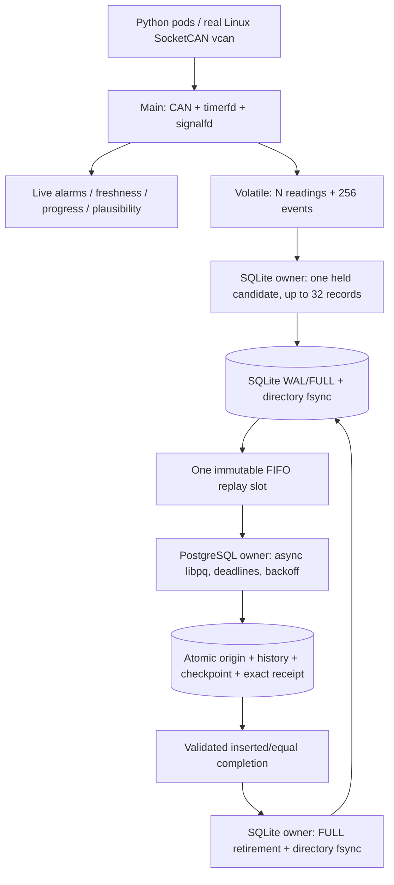

# Vigil Resilience release candidate

This is agent-performed engineering evidence for independent review, not an
independent verification or a deployed release. The exact candidate identity,
clean-gate outcomes and open limitations are in [RESILIENCE_STATE.md](RESILIENCE_STATE.md).
The original brief's owner-first implementation process was explicitly changed
by the owner's authorization; one Codex agent performed this stage.

## Implemented architecture and event states



Only main changes live alarms or feeds the watchdog. Queue/mailbox locks cover
bounded copies, never database, filesystem or network I/O. Recovered old-run
history does not update current sensor truth. SQLite and PG have separate owners
so remote waits permit further local admission. A local retirement uncertainty
pauses further mutation until its counters and prefix reconcile. When retirement
explicitly identifies an earlier committed append awaiting publication, storage
publishes that exact held append first, then retries the confirmed retirement.
This narrow ordering rule and the independent audit repairs are described in
[RESILIENCE_REMEDIATION.md](RESILIENCE_REMEDIATION.md).

| Evidence state | Allowed crash outcome |
| --- | --- |
| Observed, queued, or held | RAM only; may disappear; unsaved losses may be unknowable |
| Locally durable | Original identities/payloads remain in SQLite until verified retirement, under the storage assumptions |
| Pending / remote outcome unknown | Same local batch remains; remote transaction may already exist; retry exact bytes |
| Remote committed, not retired | Equal receipt makes repeated submission safe; confirmation itself is volatile |
| Locally retired | PG is retained history; local payload may be gone; prefix/counters advance atomically |

[RESILIENCE_CONTRACT.md](RESILIENCE_CONTRACT.md) defines the complete event and
failure reference and conservation equations. [OUTBOX.md](OUTBOX.md) supplies
fixed limits, error classification, grants and operator behavior. Network
transmission may repeat; the promise is idempotent verified effects, conditional
on untampered local/remote history and receipts.

## Reproduce from a fresh Linux checkout

Use an unprivileged Ubuntu 24.04 user with administrative setup access,
PostgreSQL 16 tools, GCC/Clang, CMake, cmocka, systemd and can-utils.
`scripts/setup-linux` declares the actual packages and installs pinned Python
requirements. `scripts/setup-sqlite` checks the SQLite source hash and builds
3.51.3 under `/opt/vigil-sqlite-3.51.3`; it preserves distribution SQLite.
No `npm` or alternative package manager is involved in the project build.

On Apple Silicon, `brew install lima` then `./scripts/dev up` provisions the
repository's 2-vCPU/2-GiB Ubuntu ARM64 VM. Use `./scripts/dev` to execute the
following Linux commands. After reboot, run `./scripts/vcan-up`. Keep vcan0
otherwise idle; do not run the gate, benchmark, demo or simulators concurrently.
Keep the host awake and clocks synchronized throughout a run. On macOS, prefix
the `scripts/dev` gate invocation with `caffeinate -i` to inhibit idle sleep only
for that process; avoid manual/lid suspension. Preserve failed runs if UTC and
monotonic durations diverge or a database evidence export times out.
For builds/evidence use a native Linux copy to avoid shared-mount timestamp skew:

```sh
# In Linux from the mounted repository root; choose a fresh destination.
git clone --local --no-hardlinks "$PWD" /tmp/vigil-rc-review
ln -s "$PWD/.venv" /tmp/vigil-rc-review/.venv
cd /tmp/vigil-rc-review
./scripts/check-resilience --clean --output artifacts/rc-review
```

The clone is local; it does not fetch, push, provision production databases or
install/start the default service. On another Linux host, create `.venv` in the
clone using `python3 -m venv .venv`, then
`.venv/bin/python -m pip install -r simulator/requirements.txt`.
Use the candidate commit recorded in state, not an unpinned remote branch.
Retain `gate.json` and each command's log; expectations are recorded before each
execution. The complete gate includes all Stage 3 seed schedules, original
regressions, local/remote crash cuts, real ext4 and systemd, Release, ASan/UBSan,
TSan, Helgrind, GCC analyzer, decoder fuzz, the production demo and benchmarks.
TSan's ARM64 `setarch -R` applies to its subprocess tree only.
The gate also runs 30 deterministic coordinator remediation scenarios per build:
quiet current/previous-origin recovery, directory-sync and usage-query NOMEM,
exact publication accounting and reconciliation SIGKILL cuts. Every Python test
entry refuses `-O` and `PYTHONOPTIMIZE` before fixture work; verification predicates
raise unconditionally, and negative controls exercise the refusal and bad evidence.

Hosted CI runs `scripts/check-ci --clean`: strict GCC/Clang, unprivileged outbox
units on a native local filesystem, Python/decoder CLI, disposable PostgreSQL
v1/v2 contracts, ASan/UBSan, analyzer and fuzz smoke. It requires neither sudo
mounts nor vcan/systemd. SQLite units still require supported ext4/XFS storage
and free-space assumptions; an unsupported runner fails explicitly. Actual
vcan, systemd, adversarial filesystem and full benchmarks remain Linux-local
release gates. Local CI-command success is not a new hosted Actions result.

For individual commands after building:

```sh
cmake -S . -B build-resilience-release -DCMAKE_BUILD_TYPE=Release \
  -DCMAKE_C_COMPILER=gcc -DVIGIL_BENCHMARKS=ON
cmake --build build-resilience-release --parallel 2
./scripts/demo --build build-resilience-release
./scripts/benchmark --build build-resilience-release --runs 3 --seconds 60 \
  --output artifacts/benchmark-review
.venv/bin/python tests/resilience_adversarial.py --build build-resilience-release \
  --seed 59 --output artifacts/fault-seed59-review
```

Every output directory must be fresh. Demo/benchmark allocate their own native
spool and PG cluster, stop only their own PG, close daemons in `finally`, and
remove temporary resources on normal completion, assertion failure, SIGINT or
SIGTERM. SIGKILL of the harness cannot run cleanup: inspect retained logs and
terminate only the fixture cluster/processes named there. Never stop installed
PG 16/main as a test substitute. The benchmark creates and removes a detached
worktree at the recorded original baseline, without moving an existing branch.

## Upgrade and rollback

Deployment is a separate owner-authorized operation; this stage performs none.
Stop the service before changing the binary or inspecting a spool. Preserve a
consistent stopped DB/WAL/SHM set, configuration, binary and matching dependency
versions. Do not delete sidecars or copy a running spool as an upgrade backup.
Do not operate an offline clone concurrently as an independent spool.

Apply additive PostgreSQL 001 then 002 and grant the restricted runtime role
SELECT/INSERT and EXECUTE on the two v2 functions, as described in OUTBOX.md.
Migration 001 is unchanged. Daemon startup never migrates PG. Missing 002 or
wrong durability settings leave local admission active with degraded replay;
the backlog can eventually fill. New installation requires explicit empty-store
bootstrap; a missing or invalid existing store fails before readiness.

The local schema stays version 1 and Stage 2+ reopens pending Stage 1 history.
A Stage 1 binary intentionally refuses nonzero retirements: binary downgrade is
not automatically safe. The original Vigil binary cannot replay a SQLite spool.
Returning to it requires an explicit operator plan to drain/archive the spool
and accept the original volatile crash contract. Preserve 002/history/receipts;
dropping receipts independently or restoring PG behind locally retired data
invalidates delivery evidence. No automated destructive downgrade exists.

## Capacity and power-loss assumptions

Durable ceilings are 65536 records, 4096 batches and 64 MiB payload: the first
exhausted resource stops admission. Small batches can fill the batch ceiling
far sooner than the record ceiling. Do not size an outage from records alone.
For a measured batch rate B/s, mean batch size R and payload P, the rough empty
capacity horizon is `min(4096/B, 65536/(B*R), 67108864/(B*P))` seconds. This is
planning arithmetic, not a delivery/service-rate guarantee; metadata batches,
existing backlog and other storage users reduce headroom. See measured workload
results in [RESILIENCE_PERFORMANCE.md](RESILIENCE_PERFORMANCE.md).

Bootstrap requires >=2 GiB available. Managed DB/WAL/SHM file-length bounds are
separate: DB <=512 MiB, WAL <520 MiB, SHM <=2 MiB; filesystem journal/allocation,
snapshots and other programs are additional costs. A 4-MiB WAL trigger causes
truncate checkpoint before another mutation; it is not a disk quota. Freed DB
pages are reused, not necessarily returned to the filesystem. No remote receipt
or history retention policy exists; provision and monitor PG storage separately.

SQLite FULL/WAL and directory fsync assume correct local ext4/XFS, kernel,
SQLite and media honoring flush ordering. PostgreSQL requires fsync,
full_page_writes and synchronous_commit enabled and honest remote storage.
SIGKILL is a process-death test. No actual power cut, media loss, destructive
rollback, standby failover or hardware flush qualification was executed.
SQLite may recover a valid shorter prefix after corruption destroys the last
WAL commit; universal corruption detection is not promised. The official
[SQLite WAL documentation](https://www.sqlite.org/wal.html) and
[synchronous modes](https://www.sqlite.org/pragma.html#pragma_synchronous)
explain the upstream flush/checkpoint basis; application assumptions remain in
the contract.

## Remaining evidence gaps

The full-target design matrix is broader than the executable checkpoint gate.
Forced entropy/UUID-collision failure and general allocator-exhaustion injection
were not executed; signed allocator boundaries and configured SQLite heap limits
are different evidence. There was no actual host reboot/power cut during an
outage, XFS run, remote failover, simultaneous maximum-resource stress fill or
physical CAN test. Runtime READONLY uses the test VFS; actual read-only ext4 is
an offline-store/startup test. Per-record asynchronous latency, queue-lock timing
and SQLite heap instrumentation remain unmeasured as detailed in the performance
report. These are qualification gaps, not claimed passed tests.

## Independent-review handoff

Review the current commit/digest and exact raw gate evidence in state, then
reproduce on a fresh native filesystem. Trace a committed payload through
append, original-run replay, exact PG receipt and local retirement. Audit error
classification, uncertain local outcomes, FIFO poison handling, old/current-run
cursors, bounds and cleanup. Compare every previously known durable identity
against the local/remote union, not only row counts. Review the benchmark's
measurement boundaries before interpreting comparisons. Owner understanding,
independent review, hardware/power testing, XFS execution and hosted CI on this
candidate remain separate qualifications. Stop after the local candidate;
no publication, deployment or independent-verification declaration is implied.
